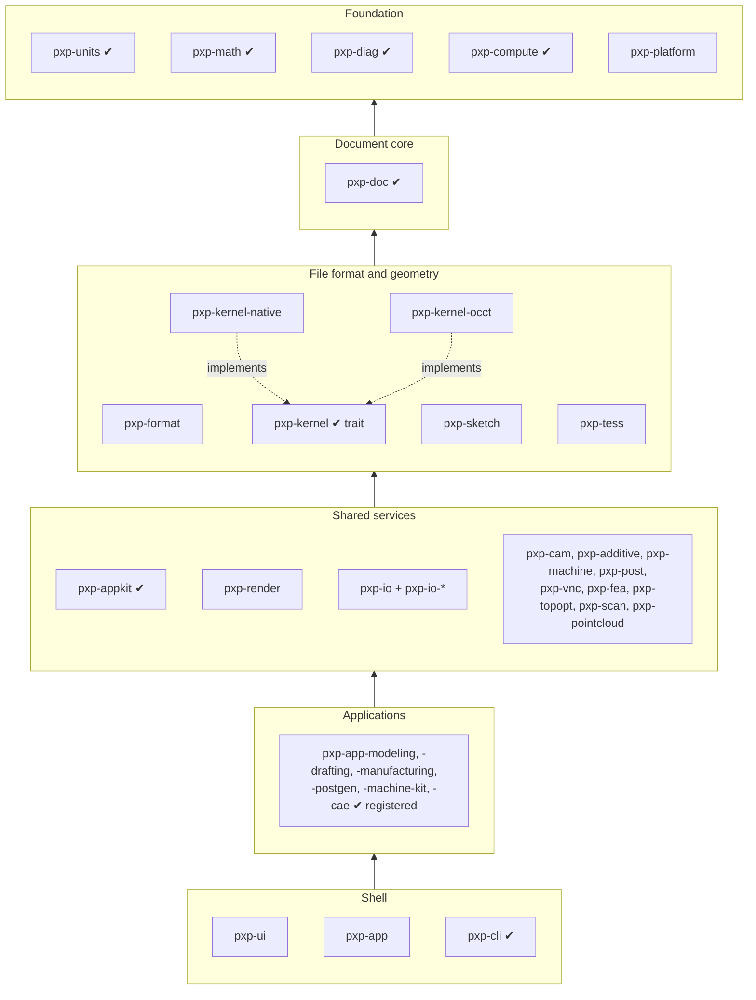

# Design note: workspace architecture and layering

The master prompt's layering, as built in session 1. `tools/layers.toml` is
the machine-readable version and `tools/check_repo.py` enforces it in CI.

✔ = implemented in session 1 (see `docs/STATUS.md` for scope).

## Rules (enforced)

1. A crate depends only on its own layer or lower layers.
2. Applications never depend on each other; they share domain libraries.
3. Only shell crates name a concrete kernel backend; everything else uses the
   `pxp-kernel` trait through `KernelHost`.
4. Every crate is assigned to exactly one layer.
5. Every crate root has `#![forbid(unsafe_code)]`; future FFI crates are
   listed explicitly in `[unsafe].allow` with an ADR.

## Why the extra crate `pxp-appkit`

The master prompt's `Application` trait mentions `CommandSpec`, `ChangeSet`
and `UiContext`. The document core must not know about UI, and applications
must not depend on each other, so the trait and the registry live in their
own shared-services crate. `UiContext` is a toolkit-neutral description
(tabs, navigators, active application) that `pxp-ui` renders.
