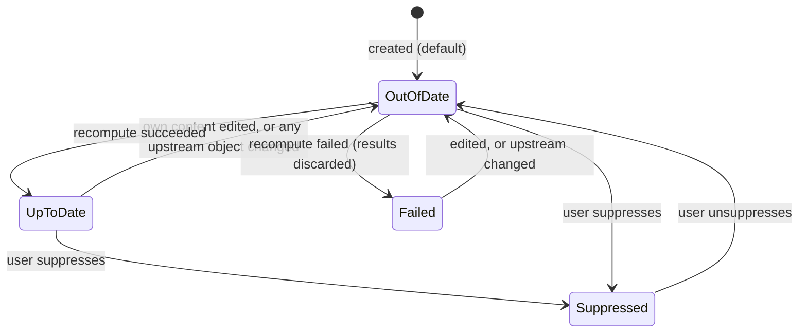
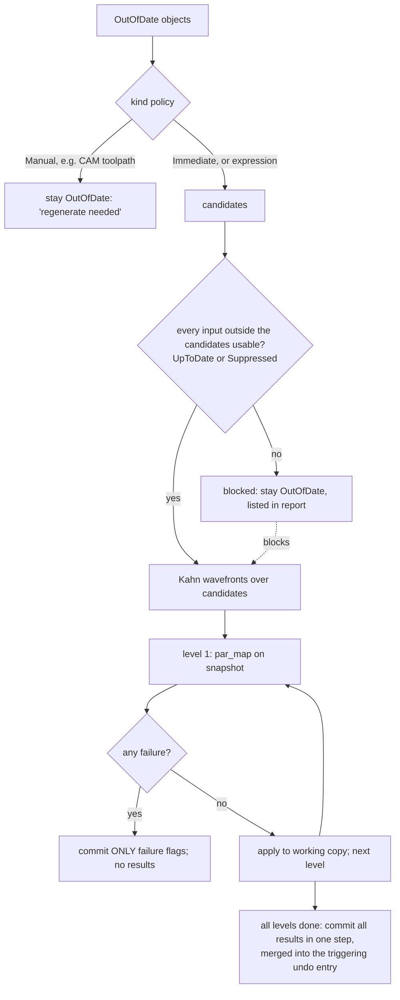

# Design note: the document core (transactions, undo, recompute graph)

Code: `crates/pxp-doc`. Decisions: ADR-0006. Keep the diagrams in sync with
the code.

## 1. Objects and state

A document is a set of objects keyed by `ObjectId` (UUIDv7). Each object has
a namespaced kind (`modeling.extrude`), an owning application, typed
properties (`Value`), a set of dependencies (`Dep { on, role }`), an opaque
versioned payload, a layer (1..=256), a recompute state and an optional
diagnostic.



`DocState` holds the objects as `Arc<Object>` plus two indexes derived in
exactly one function, `replace_raw`: the reverse dependency index
(`dependants[x]` = objects that depend on `x`) and the expression-name index.

## 2. Transactions

```mermaid
sequenceDiagram
    participant C as Command
    participant D as Document
    participant T as Tx (working copy)
    participant U as Undo stack
    participant B as Change bus
    C->>D: transact("Block", |tx| ...)
    D->>T: clone state (pointer copies)
    C->>T: create / update / delete / set_expression
    T->>T: validate each write (deps exist, no cycle, unique names)
    alt closure returned Err or panicked
        D-->>C: Err (working copy dropped; state untouched)
    else closure returned Ok
        T->>T: finish(): propagate OutOfDate, diff against base
        D->>D: state = working copy; generation += 1
        D->>U: push entry {label, before/after Arcs of touched objects}
        D->>B: publish ChangeSet {created, modified, deleted}
        D-->>C: Ok(value)
    end
```

Panics are caught with `catch_unwind` at this boundary (master prompt). The
working copy is discarded, so a panic can never leave a half-applied edit.

### Out-of-date propagation at commit

1. An object whose **own content** changed becomes `OutOfDate`, unless the
   transaction set its state explicitly (a creator's initial state,
   `set_state`, or `set_expression`'s eager evaluation) or it is suppressed.
2. Every **transitive dependant** of a changed, deleted or (un)suppressed
   object becomes `OutOfDate` unless it is suppressed, **even if its state was
   set explicitly earlier in the same transaction**.

Rule 2 deliberately ignores explicit states. Counter-example it prevents:
in one transaction, define `p3 = p2 * 2` (evaluated eagerly from `p2`'s
cached value), then change `width`, which `p2` depends on. `p3`'s value is
now stale; if an explicit state protected it, a stale value would be
labelled up to date. With rule 2, `p3` is out of date and recompute fixes it.

## 3. Undo and redo

An undo entry maps each touched `ObjectId` to `(before, after)` shared
objects. Undo writes every `before` back with `replace_raw` (in any order;
the indexes end consistent because each write is applied exactly once);
redo writes every `after`. A new commit clears the redo stack. The history
is unlimited in count and capped in estimated bytes; the oldest entries drop
first and the newest is always kept.

Recompute results are **merged into the entry of the edit that caused
them**, if the document has not changed since that entry was applied
(generation check). One undo then reverts the edit and its geometry
together. Otherwise recompute records its own "Update" entry.

## 4. Recompute graph



- Levels are sorted by ID and `par_map` preserves input order, so recompute
  is deterministic (tested: 500 independent expressions recompute in the
  same order on every run).
- Each handler call runs under `catch_unwind`; a panicking handler is a
  failure with a message, never a crash.
- A `CancelToken` is checked between levels; cancellation commits nothing.

## 5. Readers and snapshots

`Document::snapshot()` returns an `Arc` of the current state: O(1) to take,
never changes afterwards. The UI, renderer and solvers read snapshots and
never lock the document.

## 6. Not yet implemented (next sessions)

- **Persistent naming** (`topo_names`): names built from `TopoHistory`
  chains; resolution after edits; broken references with a repair dialog,
  never a silent re-bind. Needs a kernel backend (0F) to be meaningful.
- **Recovery journal and saving** (`pxp-format`, 0E).
- **Document thread**: a dedicated thread owning `&mut Document`, with
  commands sent over a channel (with the UI, 0H).
