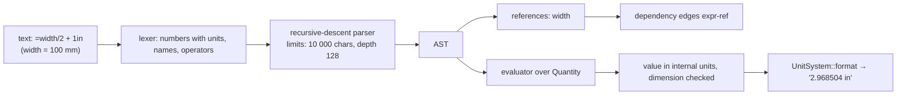

# Design note: expressions and units

Code: `crates/pxp-units`, `crates/pxp-doc/src/expr.rs`. Decisions: ADR-0007.

## Pipeline



## Grammar

```text
expr    := ['='] sum
sum     := product (('+' | '-') product)*
product := unary (('*' | '/') unary)*
unary   := ('-' | '+') unary | power
power   := primary ('^' unary)?
primary := NUMBER [UNIT] | NAME | NAME '(' args ')' | '(' expr ')'
UNIT    := letters touching the number (25.4mm) | '[' unit-expression ']'
```

## Examples (all verified by tests)

| Input | Result |
| --- | --- |
| `1in + 25.4mm` | 50.8 mm |
| `7850[kg/m^3] * (100mm)^3` | 7.85 kg |
| `sin(30) + cos(60deg)` | 1 (bare numbers are degrees, as in NX) |
| `sqrt(width*width)` | a length |
| `10mm + 5deg` | error: dimension mismatch |
| `sqrt(10mm)` | error: no physical meaning |
| `1/0`, `asin(2)` | error: not a finite number |

## Internal units

Coherent mm-t-s: length mm, mass tonne, time s, angle rad; therefore force N,
stress MPa, energy N·mm, density t/mm³. Display through `UnitSystem`
(millimetre parts: mm, kg, N, MPa; inch parts: in, lbm, lbf, psi; angles in
degrees in both).

## Try it

```sh
pxp-cli eval "p1" --let "width=4in" --let "p1=width*2 + 0.5mm" --units in --decimals 4
# 8.0197 in
```
