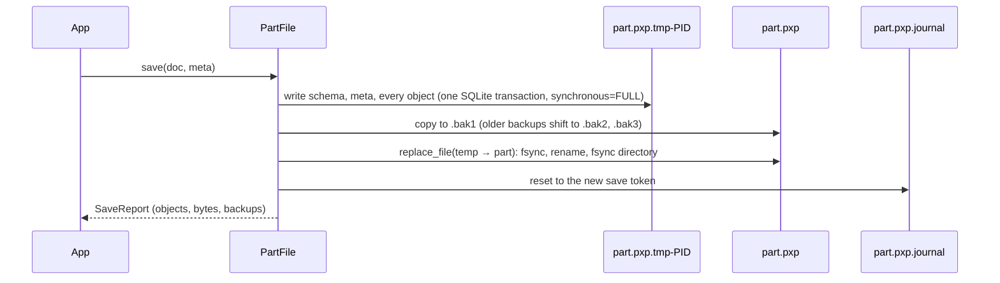
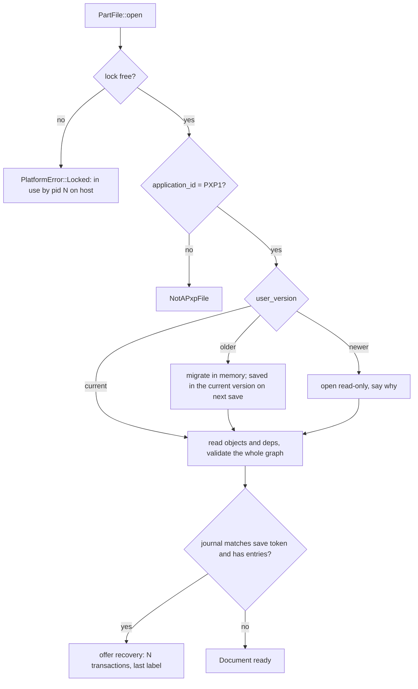

# Design note: the `.pxp` part file

Code: `crates/pxp-format` (container), `crates/pxp-platform` (locks, atomic
replace), `crates/pxp-kernel` (stored-shape envelope). Decision: ADR-0003.

## What is in a file

A `.pxp` is one SQLite database (bundled SQLite through `rusqlite`), marked
with `PRAGMA application_id = 0x50585031` ("PXP1") and
`PRAGMA user_version = 1` (schema version).

| Table | Holds |
| --- | --- |
| `meta` | Part settings and file identity: `units` (`mm`/`in`), `distance_tolerance_mm`, `angle_tolerance_rad` (f64 little-endian), `writer`, `save_token` (16 random bytes, changed on every save) |
| `objects` | One row per document object: id (16-byte UUIDv7), kind, kind version, owning application, parent, name, layer, recompute state, diagnostic, properties (explicit binary codec), payload (split into 8 MiB chunks) |
| `deps` | Dependency edges `(from, to, role)`, indexed by target for "what depends on this" |
| `blobs` | Large shared binary data, chunked (reserved for meshes and attachments) |

Object properties use an explicit, versioned binary codec
(`pxp_format::codec`), not serde: renaming a Rust field can never change the
file format. Unknown kinds are kept byte for byte, so a file written by a
newer application or plugin survives a round trip through an older one.

### Geometry

A solid feature (for example `modeling.block`) stores its exact B-rep in the
object **payload**, wrapped in the stored-shape envelope from `pxp-kernel`:

```text
"PXPB" | envelope version (u8) | backend id length (u8) | backend id | native length (u64 LE) | native bytes
```

The native bytes are the backend's own versioned format (for SolidCraft,
its native body encoding). The feature's `geometry_hash` property records
the hash computed when it was regenerated, so a reopened file can prove its
geometry is unchanged without recomputing (`pxp-cli part verify`).

## Saving



A crash at any point leaves either the old file or the new one, never a mix:
the rename is atomic, and the temporary file is complete and synced before
it happens.

## Sidecar files

| File | Purpose | Lifetime |
| --- | --- | --- |
| `part.pxp.lock` | OS advisory lock (`std::fs::File::try_lock`) plus "pid N on host" for the "in use by" message | Kept after close (deleting it safely would need every platform to re-check the file's identity after locking) |
| `part.pxp.journal` | Recovery journal: every committed transaction since the last save, written with `synchronous=FULL` | Reset on save; deleted by `PartFile::close` when it holds no unsaved work |
| `part.pxp.bak1..3` | The three previous saves | Rotated on every save |

## Opening



Invalid contents (a dependency on a missing object, a cycle, a duplicate
expression name) are refused with `InvalidContent`, never loaded half-way.
