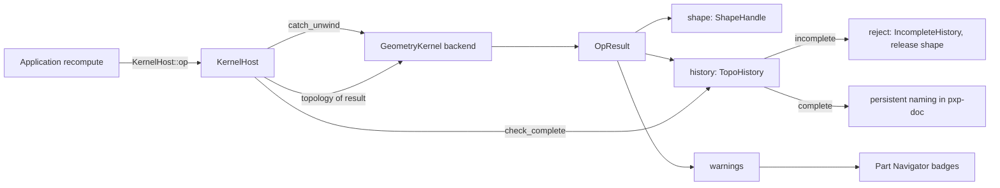

# Design note: the geometry kernel contract

Code: `crates/pxp-kernel`. Plan: ADR-0004.

## The contract

- **Every** topological operation returns `OpResult { shape, history,
  warnings }`.
- `TopoHistory` has one record per output vertex, edge and face: the
  relation (generated or modified) and its sources, which are input entities
  (`Input { operand, entity }`), profile curves (`Profile { curve }`), or
  semantic roles for entities with no input (`Role("block.z_max")`).
  Primitive face roles are part of the naming contract and never change
  after release.
- `KernelHost::op` checks history completeness **before** anyone can store
  the result. Backends that cannot provide history fail loudly instead of
  silently breaking associativity in Drafting, CAM and CAE.
- Backends implement `capabilities()`; the UI greys out what is missing.
  Unsupported operations return `KernelError::Unsupported`, never invented
  geometry.
- Methods take `&self` and the trait is `Send + Sync`, because recompute
  calls the kernel from several threads at once.

## Hosting

In-process hosting with panic containment exists now. Native backends (OCCT)
can crash the process in ways `catch_unwind` cannot stop; sub-stage 0F adds
out-of-process hosting: a worker per backend, a versioned request/response
protocol, automatic restart, and replay or rollback of the in-flight
document transaction.

## How persistent naming will use the history (planned)

A persistent name is a chain of steps, one per feature that touched the
entity: `(feature ObjectId, relation, source)`. On recompute, each stored name
is resolved by walking the new history maps from the feature's inputs. If no
entity matches, or several do and no rule disambiguates, the reference
becomes **broken** (shown in the navigator with a repair action), never
re-bound to a guess. Inputs to the design: FreeCAD 1.0's toponaming work
(LGPL-2.0-or-later, study only) and the OCCT `BRepTools_History`
generated/modified/deleted model.
