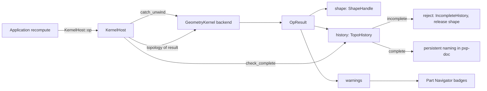
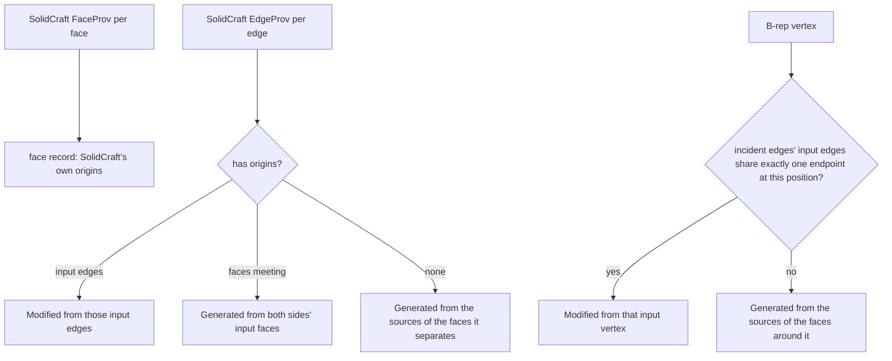

# Design note: the geometry kernel contract

Code: `crates/pxp-kernel`. Plan: ADR-0004.

## The contract

- **Every** topological operation returns `OpResult { shape, history,
  warnings }`.
- `TopoHistory` has one record per output vertex, edge and face: the
  relation (generated or modified) and its sources, which are input entities
  (`Input { operand, entity }`), profile curves (`Profile { curve }`), or
  semantic roles for entities with no input (`Role("block.z_max")`).
  Primitive face roles are part of the naming contract and never change
  after release.
- `KernelHost::op` checks history completeness **before** anyone can store
  the result. Backends that cannot provide history fail loudly instead of
  silently breaking associativity in Drafting, CAM and CAE.
- Backends implement `capabilities()`; the UI greys out what is missing.
  Unsupported operations return `KernelError::Unsupported`, never invented
  geometry.
- Methods take `&self` and the trait is `Send + Sync`, because recompute
  calls the kernel from several threads at once.
- An operation that succeeds but leaves no material (a subtract whose tool
  swallows the target) returns `KernelError::EmptyResult`, never an empty
  body.
- `export_native` / `import_native` move a shape's exact B-rep in and out
  of the backend in its own versioned format. Documents store it wrapped in
  the **stored-shape envelope** (`encode_stored_shape`): `"PXPB"`, envelope
  version, backend id, length-prefixed native bytes. The backend id tells a
  reopened file which kernel wrote the geometry.
- `geometry_hash(shape, resolution)` is platform-independent: coordinates
  are quantised to `resolution` (documents use
  `DEFAULT_HASH_RESOLUTION` = 1 nm) so last-bit differences between
  platform maths libraries do not change it.

## Derived records

`check_complete` requires a record for every vertex, edge and face. A
kernel may report provenance for faces only, or leave new edges without an
origin. A backend may then **derive** the missing records from exact
adjacency, never from geometric guesses, and must document the rules in its
crate docs. The SolidCraft backend (`pxp-kernel-native`, module `history`)
does this:

A block's top-front edge is therefore "generated from `block.z_max` and
`block.y_min`", and a block corner kept by a boolean is "modified from
vertex 3 of operand 0". `deleted` lists every input face, edge and vertex no
output names. If SolidCraft ever returns a body without history the adapter
returns an empty history and `KernelHost::op` rejects it.

## Backends

| Backend | Crate | Hosting | Status |
| --- | --- | --- | --- |
| SolidCraft kernel (on SolidCore) | `pxp-kernel-native` | in-process (safe Rust) | primitives, booleans, history, hash, native B-rep I/O (session 2); exact bounding box, STEP import and export through SolidCraft's own translator (session 3) |
| OCCT | `pxp-kernel-occt` | worker process | session 3 |

## STEP translation through the kernel

`GeometryKernel::import_step` and `export_step` (default: `Unsupported`)
let each backend use its own STEP translator: SolidCraft has one written
from the public standards, OCCT has `STEPControl`. An import returns
`StepImport`: the bodies (each flagged `closed` and `mesh`), how many of
the file's parts came in closed, the schema, and every warning, so nothing
the translator skipped is hidden. Imported bodies have no history (an
import starts a part). `bounding_box` returns the exact box on the curves
and surfaces, which the STEP stress checks use to place their tools.

`pxp-io-step` (Stage 1, sub-stage 1E) will put the product-level translator
on top: colours, names, layers, assemblies and, from Stage 2, semantic PMI.
Until then these trait methods are what the bake-off measures.

## Bake-off harness

`pxp_kernel::bakeoff` runs a corpus of cases through any `KernelHost` and
grades each against an answer that never comes from a kernel. Run it with
`pxp-cli bakeoff`; ADR-0004 records the results.

`pxp-cli stepstress FILE|DIR...` runs the STEP corpus (the NIST MBE PMI test
models, fetched with checksums by `tools/fetch_nist_step.py`). Per file it
grades the import against the geometric validation properties the
exporting CAD system wrote into the file (read by a small independent
Part 21 reader, `bakeoff::p21`, never by the kernel), round-trips the bodies
through native bytes and through STEP, and checks inclusion-exclusion
identities of booleans against a box, a half-space and a drilled cylinder
(`V(A−T)+V(A∩T)=V(A)`, `V(A∪T)+V(A∩T)=V(A)+V(T)`, the same for areas).
The nightly workflow runs it on every OS and compares hashes.

## Hosting

In-process hosting with panic containment exists now, and is what the
safe-Rust SolidCraft backend uses. Native backends (OCCT) can crash the
process in ways `catch_unwind` cannot stop; the OCCT half of sub-stage 0F
(session 3) adds out-of-process hosting: a worker per backend, a versioned
request/response protocol, automatic restart, and replay or rollback of the
in-flight document transaction.

## How persistent naming will use the history (planned)

A persistent name is a chain of steps, one per feature that touched the
entity: `(feature ObjectId, relation, source)`. On recompute, each stored name
is resolved by walking the new history maps from the feature's inputs. If no
entity matches, or several do and no rule disambiguates, the reference
becomes **broken** (shown in the navigator with a repair action), never
re-bound to a guess. Inputs to the design: FreeCAD 1.0's toponaming work
(LGPL-2.0-or-later, study only) and the OCCT `BRepTools_History`
generated/modified/deleted model.
